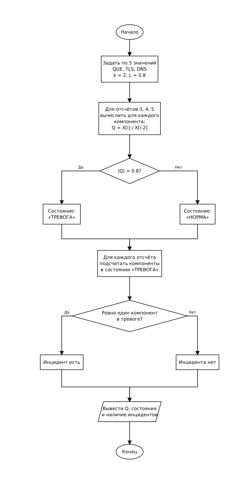

# Курсовой проект: Программа контроля облачной инфраструктуры

## Контрольная точка 1 (КТ1): Пять тестовых значений - формулы и базовый контроль

Программа рассчитывает показатели динамики компонентов облачной инфраструктуры и проверяет наличие инцидентов по заданному правилу.

Цель КТ1 - проверить расчёт темпа роста и правило контроля на пяти тестовых отсчётах. Данные заданы массивами в программе, период сравнения фиксирован: `k = 2`.

### Вариант 8

- Компоненты: `QUE`, `TLS`, `DNS`.
- Порядок полей: значение, время, компонент.
- Разделитель: запятая; дробная часть числа отделяется точкой.
- Тип последовательности: 5. Встречаются неизвестные коды компонентов, такие записи нужно пропускать.
- Производный показатель: темп роста.
- Параметры: `k = 2`, `L = 0.8`, `D = 5`.
- Состояние компонента: «ТРЕВОГА», если модуль показателя больше `L`, иначе «НОРМА».
- Инцидент возникает, если ровно один компонент проблемный, а два остальных находятся в состоянии «НОРМА».

Параметр `D` указан в карточке варианта, но в формулу темпа роста не входит.

Единицы измерения исходных показателей в карточке не заданы. Для расчёта используются значения из задания.

**Структура Incident по заданию:**

```c
typedef struct {
    int time;
    int type;
    int count;
    float value;
} Incident;
```

Поля: номер отсчёта, тип инцидента, число проблемных компонентов и значение показателя.

### Формат исходных данных

Телеметрия из карточки варианта, одной строкой:

```text
35.2,4,DNS,53.8,1,TLS,30.6,3,DNS,44.2,2,QUE,31.3,2,DNS,50.6,4,QUE,51.1,5,QUE,51.2,5,TLS,34.5,5,DNS,43.7,1,QUE,44.7,3,QUE,57.2,2,TLS,32.0,1,DNS,73.0,2,XYZ,55.2,3,TLS,76.0,5,XYZ,53.2,4,TLS
```

### Формула и правило контроля

Для каждого компонента:

$$
Q_i = \frac{X_i}{X_{i-k}}, \qquad k = 2.
$$

При нумерации отсчётов от 1 показатель можно вычислить для `i = 3, 4, 5`: используются пары (3, 1), (4, 2) и (5, 3). Для первых двух отсчётов предыдущих данных недостаточно. Их состояние не приравнивается к норме, проверка инцидента для них не выполняется.

Все знаменатели тестового набора положительны и не равны нулю. Обработка произвольных данных и ошибок вычислений предусмотрена в КТ2.

Состояние компонента:

$$
S_i =
\begin{cases}
\text{ТРЕВОГА}, & |Q_i| > 0.8, \\
\text{НОРМА}, & |Q_i| \leq 0.8.
\end{cases}
$$

Пусть `A`, `B`, `C` означают наличие тревоги у QUE, TLS и DNS на одном отсчёте. Тогда правило инцидента:

$$
I = (A \land \neg B \land \neg C)
\lor (\neg A \land B \land \neg C)
\lor (\neg A \land \neg B \land C).
$$

В программе логические результаты сравнения равны 0 или 1. Поэтому достаточно подсчитать проблемные компоненты и проверить `problem_count == 1`.

---

## 1. Алгоритм и блок-схема

1. Задать пять измерений для каждого компонента, период 2 и порог 0.8.
2. Вывести исходные данные.
3. Сообщить, что для первых двух отсчётов не хватает предыдущих данных.
4. Для отсчётов с третьего по пятый вычислить Q каждого компонента.
5. Сравнить модуль Q с порогом и вывести состояние компонента.
6. Подсчитать проблемные компоненты. Если их ровно один, зафиксировать наличие инцидента.
7. Вывести общее число инцидентов.

### Блок-схема (КТ1)



---

## 2. Контрольный пример: ручной расчёт

### Исходные данные по отсчётам

Записи `73.0,2,XYZ` и `76.0,5,XYZ` относятся к неизвестному компоненту. При подготовке тестовых массивов они исключены вручную, а остальные измерения расположены по времени. Автоматический разбор строки в КТ1 не выполняется.

| Отсчёт | QUE | TLS | DNS |
|---:|---:|---:|---:|
| 1 | 43.7 | 53.8 | 32.0 |
| 2 | 44.2 | 57.2 | 31.3 |
| 3 | 44.7 | 55.2 | 30.6 |
| 4 | 50.6 | 53.2 | 35.2 |
| 5 | 51.1 | 51.2 | 34.5 |

Всего используется 15 измерений: по пять для каждого компонента.

### Ручной расчёт показателя Q при k = 2

**Отсчёт 3 - сравнение с отсчётом 1:**

- QUE: $Q[3] = \frac{44.7}{43.7} \approx 1.0229$.
- TLS: $Q[3] = \frac{55.2}{53.8} \approx 1.0260$.
- DNS: $Q[3] = \frac{30.6}{32.0} \approx 0.9563$.

**Отсчёт 4 - сравнение с отсчётом 2:**

- QUE: $Q[4] = \frac{50.6}{44.2} \approx 1.1448$.
- TLS: $Q[4] = \frac{53.2}{57.2} \approx 0.9301$.
- DNS: $Q[4] = \frac{35.2}{31.3} \approx 1.1246$.

**Отсчёт 5 - сравнение с отсчётом 3:**

- QUE: $Q[5] = \frac{51.1}{44.7} \approx 1.1432$.
- TLS: $Q[5] = \frac{51.2}{55.2} \approx 0.9275$.
- DNS: $Q[5] = \frac{34.5}{30.6} \approx 1.1275$.

Результаты округлены до четырёх знаков после точки. Сравнение с порогом выполняется до округления.

### Состояния компонентов и инциденты при L = 0.8

| Отсчёт | Q(QUE) | Q(TLS) | Q(DNS) | QUE | TLS | DNS | Инцидент |
|:---:|---:|---:|---:|:---:|:---:|:---:|:---:|
| 1 | — | - | - | Нет данных для Q | Нет данных для Q | Нет данных для Q | Не проверяется |
| 2 | - | - | - | Нет данных для Q | Нет данных для Q | Нет данных для Q | Не проверяется |
| 3 | 1.0229 | 1.0260 | 0.9563 | ТРЕВОГА | ТРЕВОГА | ТРЕВОГА | Нет |
| 4 | 1.1448 | 0.9301 | 1.1246 | ТРЕВОГА | ТРЕВОГА | ТРЕВОГА | Нет |
| 5 | 1.1432 | 0.9275 | 1.1275 | ТРЕВОГА | ТРЕВОГА | ТРЕВОГА | Нет |

На отсчётах 3, 4 и 5 модуль каждого показателя больше 0.8, поэтому все три компонента находятся в состоянии «ТРЕВОГА». Условие инцидента требует ровно один проблемный компонент. Здесь их три, значит, условие не выполняется.

Ожидаемый результат: **0 инцидентов**. Для первых двух отсчётов показатель не вычисляется из-за недостатка предыдущих данных.

---

## 3. Реализация программы

Исходный код: [Source.c](Source.c).

Проект Visual Studio: [course_project.sln](course_project.sln).

В КТ1 вычисления и проверка правила выполняются в `main`. В программе используются три массива по пять значений, порог `L = 0.8` и период `k = 2`. Чтение файла, настройка периода, выделение функций и сохранение журнала относятся к следующим этапам.

---

## 4. Результаты работы программы

Ожидаемый вывод для сравнения с ручным расчётом:

```text
Здравствуйте! Программа проверяет состояние компонентов QUE, TLS и DNS.
Вариант 8. Пять отсчётов, k = 2, L = 0.8.

Исходные данные:
Отсчёт  QUE   TLS   DNS
1  43.7  53.8  32.0
2  44.2  57.2  31.3
3  44.7  55.2  30.6
4  50.6  53.2  35.2
5  51.1  51.2  34.5

Для отсчётов 1 и 2 недостаточно предыдущих данных.

Отсчёт 3:
QUE: Q = 1.0229, ТРЕВОГА
TLS: Q = 1.0260, ТРЕВОГА
DNS: Q = 0.9563, ТРЕВОГА
Проблемных компонентов: 3. Инцидента нет.

Отсчёт 4:
QUE: Q = 1.1448, ТРЕВОГА
TLS: Q = 0.9301, ТРЕВОГА
DNS: Q = 1.1246, ТРЕВОГА
Проблемных компонентов: 3. Инцидента нет.

Отсчёт 5:
QUE: Q = 1.1432, ТРЕВОГА
TLS: Q = 0.9275, ТРЕВОГА
DNS: Q = 1.1275, ТРЕВОГА
Проблемных компонентов: 3. Инцидента нет.

Всего инцидентов: 0.
```

Расчётные значения Q приведены в разделе 2. При запуске нужно проверить совпадение всех девяти значений, состояний компонентов и итогового числа инцидентов.

Сборка и запуск в Visual Studio пока не выполнены. Приведённый вывод - ожидаемый результат, а не протокол запуска.

---

## 5. Вывод

В ходе работы научился рассчитывать темп роста по пяти тестовым отсчётам и определять наличие инцидента по состояниям трёх компонентов.

---

## 6. Информация о разработчике

- **Студент:** Гордиенко Владимир Денисович.
- **Группа:** бОТИ-261.
- **Год:** 2026.
